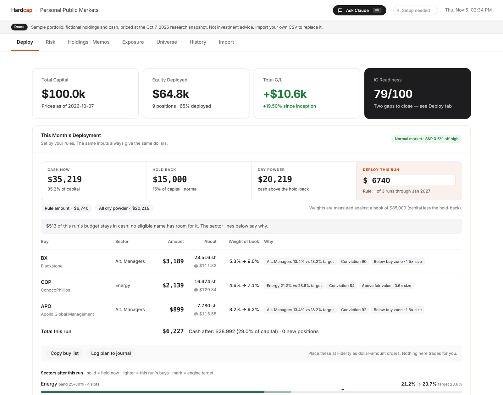
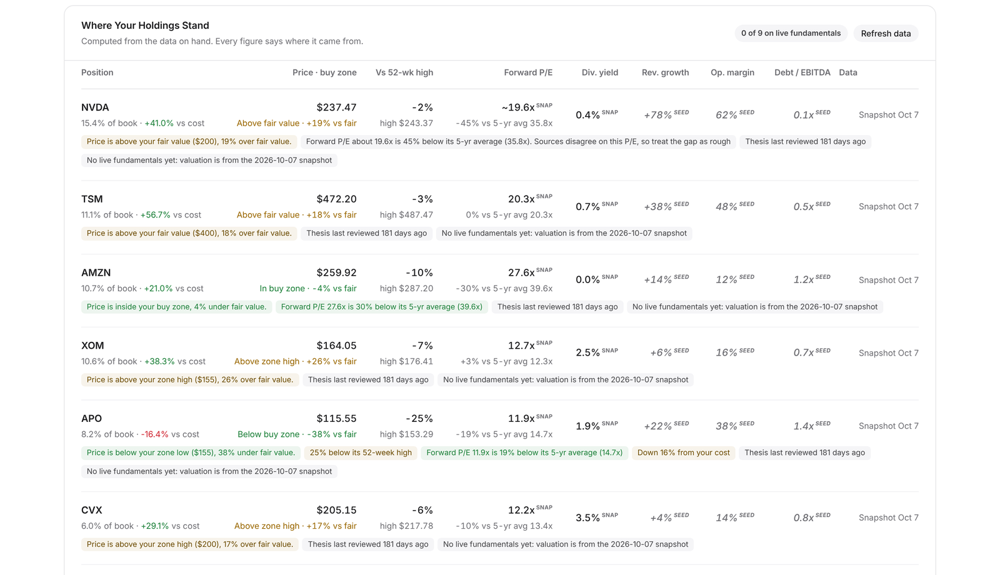
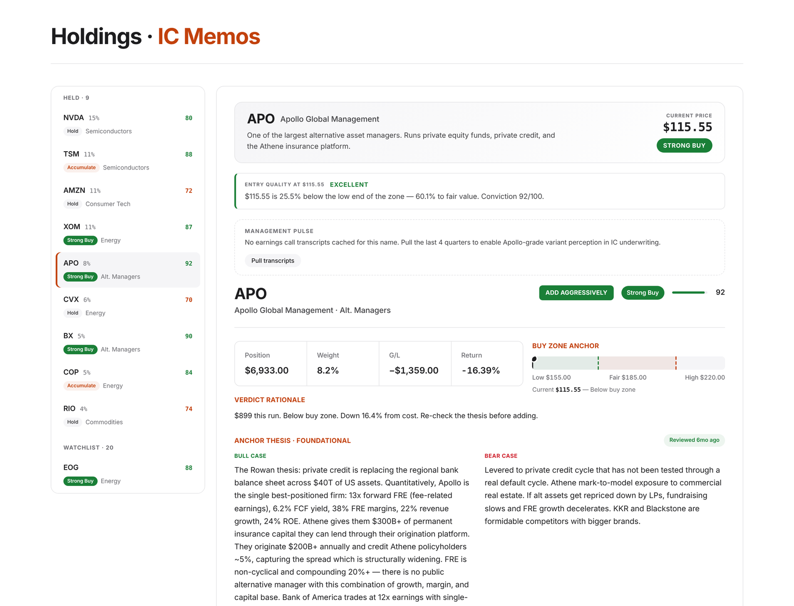
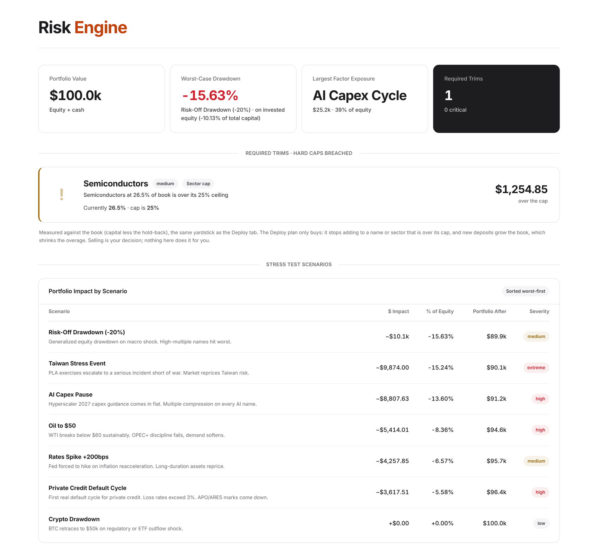

# Hardcap

[](https://github.com/RABosch1/hardcap/actions/workflows/test.yml)

**A personal investment committee in a browser tab.** A deterministic rules engine decides how much cash to invest each month and where it goes. An LLM investment committee then underwrites that plan against the data, and any change it suggests waits for my approval.

**[Live demo →](https://rabosch1.github.io/hardcap/)** · runs on a fictional $100K sample portfolio · no login, no backend



---

## Why I built it

Most portfolio tools tell you what you own. I wanted one that tells you **what to do with the next dollar, and why**, with the discipline an institutional investment committee applies:

- Every position has a written thesis, a buy zone and explicit "change my mind" triggers.
- Sector bands and a single-name cap are enforced by the engine, not suggested.
- New cash is deployed on a schedule by fixed rules, so the same inputs always give the same dollars.
- An LLM committee tests each buy against the numbers, with a quantified downside and a kill switch, before anything changes.

---

## What it does

| Tab | What it does |
|---|---|
| **Deploy** | This month's plan: how much to invest, which names, how many dollars each, and the reason for every amount. Copy the buy list or log it to a journal. |
| **Investment Committee** | LLM review of the plan at three depths (Fast, Deep, Forensic). Writes a memo per buy and per holding, and proposes changes to my inputs that I apply or dismiss. |
| **Scorecard** | Valuation, growth, margins and leverage for each holding, with every figure tagged by source: live feed, dated snapshot, or unverified seed. |
| **Risk** | Seven stress scenarios (oil to $50, AI capex pause, Taiwan stress, private-credit defaults and more), factor exposure, worst case per name, and cap breaches. |
| **Holdings · Memos** | A three-layer thesis per name (anchor, 90-day review, dated observations) with staleness badges and the buy zone drawn against the current price. |
| **Exposure** | Sector weights against their bands, concentration, and a what-if allocator for any amount. |
| **Import** | Parses Fidelity position exports (several accounts in one file, money market as cash, pending activity). JSON backup and restore. |
| **Ask Claude** | A slide-out analyst (⌘K) that sees the whole portfolio and proposes edits as confirm/reject cards. |





---

## How the engine decides

The engine is in [`src/engine.js`](src/engine.js). It only buys; nothing in the app ever sells.

**1. How much.** Part of total capital is held back as cash, and the hold-back shrinks as the S&P 500 falls further below its 52-week high. Cash above the hold-back is dry powder, released over a schedule:

```text
hold-back   = total capital × h        h = 15% normal, 10% correction (10%+ off the high),
                                           5% bear market (20%+), 0% crash (30%+)
dry powder  = cash − hold-back
budget      = dry powder × max(1 / runs left on the schedule, s)
                                       s = 0 normal, 1/3 correction, 1/2 bear market or crash
book        = max(equity, total capital − hold-back)
```

All weights are measured against the **book**, the portfolio as it will be once the dry powder is invested, so a position does not look oversized just because cash is high.

**2. Where.** A sector whose band has a floor above zero is a core sector. Each core sector's target is its band midpoint, scaled so the core sectors fill the book. Up to 15 positions are shared across core sectors in proportion to those targets, with at least one each. Names I already hold keep their slots, and an open slot goes only to a name I have **pinned**; a highly rated name I have not pinned stays on the bench. Inside a sector, each name's target is proportional to its conviction score.

```text
sector target = book × band midpoint / Σ core midpoints
name target   = sector target × conviction / Σ conviction of the sector's slot names
gap           = max(0, name target − current value)
```

**3. Sizing.** The budget is split across eligible names in proportion to their dollar gaps, never past a name's gap, its sector's gap or the single-name cap. A buy zone reviewed in the last 120 days then tilts each amount: 1.5× below the zone low, 1× inside the zone, 0.6× above fair value, 0.3× above the zone high. Money an expensive name gives up is offered to the cheap ones, and whatever is left stays in cash. A stale or placeholder zone does not steer anything.

**4. Limits.** No buy lifts a name above 22% of the book. An order under $150 is dropped and its share goes to the other names. Only Strong Buy and Accumulate signals receive money; Hold, Watch and never-buy names receive none. Every number above is a setting on the Deploy tab.

In the screenshot, Alt. Managers and Energy are below target, so they get the money. Blackstone and Apollo trade below their buy zones and are sized up; ConocoPhillips is above fair value and sized down. Semiconductors are above target and get nothing, and $513 that no name has room for stays in cash.

---

## The AI layer

The investment committee lives in [`src/ic.js`](src/ic.js). The rules engine sets every dollar; the committee never changes an amount. Its job is to say whether each buy stands up, and where it disagrees, which of my inputs (signal, conviction, buy zone) it would change.

| Tier | Model | Data it pulls first | Output |
|---|---|---|---|
| Fast | Claude Sonnet, low effort | None; uses what is on hand | Two sentences per buy, one line per holding |
| Deep | Claude Opus, medium effort | Fundamentals for any name missing them | A short memo per buy and holding, with a kill switch each |
| Forensic | Claude Opus, high effort | Fresh quotes, five years of financials, estimates, earnings calls | Full memo per buy (variant perception, quantified downside, catalysts) and a data-backed rundown of every holding |

Design choices that keep it honest:

- **Evidence rules in the prompt.** Every number cited must appear in the data sent with the request. Figures arrive tagged `live`, `snap` (dated snapshot) or `seed` (unverified), and the model must say "not in data" rather than fill a gap from memory.
- **The model proposes, I decide.** Suggested changes come back as structured action blocks. Before they are shown, [`sanitizeICActions`](src/ic.js) drops anything unsafe: sell signals, never-buy names, conviction outside 0–100, malformed buy zones and HTML. What survives is shown as Apply / Dismiss cards.
- **Cost shown before running.** Each tier displays an estimated cost from the size of its prompt and the data it will pull.

---

## Architecture

```text
index.html                  page shell; loads src/ in order (no build step)
src/
├── data/
│   ├── universe.js         29 names: thesis, buy zone, conviction, fundamentals
│   ├── sectors.js          sector bands and ticker-to-sector map
│   ├── research-snapshot.js  dated prices and valuation context (Oct 7, 2026)
│   └── sample-portfolio.js the fictional $100K demo book
├── state.js                localStorage persistence, Fidelity CSV parser, backups
├── analytics.js            weights, book value, sector gaps
├── engine.js               the deployment rules: budget, slots, sizing, caps
├── risk.js                 stress scenarios, factor exposure, trims
├── scorecard.js            per-holding fact sheet with source tags
├── live-data.js            market-data client (calls the worker)
├── transcripts.js          earnings-call cache and compression
├── claude-client.js        streaming Messages API client
├── ic.js                   investment committee: context, prompt, guardrails
├── chat.js                 Ask Claude: system prompt, action proposals
├── render.js, plan-ui.js   DOM rendering
└── app.js                  bootstrap and event wiring
worker/                     Cloudflare Worker that keeps the data-feed token server-side
test/                       36 tests on Node's built-in runner, no dependencies
```

- **No backend, no build.** Plain scripts loaded in order; GitHub Pages serves the repo as it is. `npm run bundle` produces a single offline HTML file.
- **State stays in the browser.** Positions, theses and settings live in `localStorage`, with JSON export and restore.
- **Secrets stay server-side.** Market data goes through a [Cloudflare Worker](worker/src/index.js) that holds the provider token; the page never sees it. See [docs/data-feed.md](docs/data-feed.md).

---

## Running it

```bash
git clone https://github.com/RABosch1/hardcap.git
cd hardcap
npm test           # 36 tests: engine rules, CSV parsing, stress math, AI guardrails, worker
open index.html    # or double-click it; no server needed
```

Tests need Node 22 or later and install nothing. To run on your own portfolio, drop a Fidelity positions CSV into the Import tab; the sample is replaced. Live data and the investment committee are optional: see [docs/data-feed.md](docs/data-feed.md) for the worker, and add an Anthropic API key in Import → Settings for the committee.

---

## How this was built

I designed the investment process: the sector bands, the deployment rules, the thesis structure, the stress scenarios, and what the committee is asked to check. I built the code iteratively with Claude as a coding partner, including the module structure and a test suite that pins down the rules I care about most: the budget, the caps, pinning, the price tilt and the guardrails on what the model may change.

## Limitations

- The theses, buy zones and seed fundamentals in the universe were written in mid-2026 and are illustrative. The scorecard tags seed figures so they are never mistaken for live data.
- Stress tests apply fixed factor shocks with hand-set loadings. They are not a historical simulation and ignore correlations.
- The engine is a transparent rules-based allocator, not a mean-variance optimizer. That is a deliberate trade for explainability: every dollar has a stated reason.
- Only Fidelity's CSV export format is parsed.
- An LLM can still be wrong. The evidence rules and the approval step reduce that risk; they do not remove it.

## Roadmap

- [ ] Backtest the deployment rules against a simple monthly-rebalance baseline
- [ ] Replace fixed stress shocks with historical-scenario replay
- [ ] Correlation-aware position caps
- [ ] CSV parsers for other brokers

---



*Not investment advice. The demo portfolio is fictional.*
